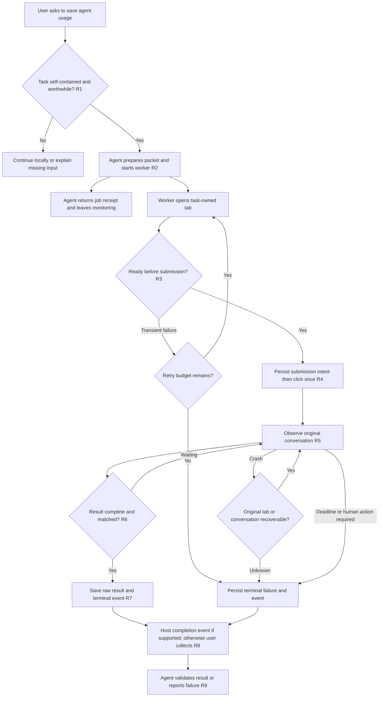

# Web Task Relay — requirements, revision 1

This is a personal open-source project for an individual coding-agent user. Its destination is `https://github.com/jiafan-tiaocan/harness`. No employer source code, internal rules, task records, account data or business examples belong in the published package.

## Problem and outcome

A user asks to conserve their coding agent's remaining usage. A substantial task can be described completely, including its input, constraints and acceptance criteria. They want their existing web-model session to do that task and return the answer for local verification. The user explicitly requires automatic opening, submission, waiting and collection, accepts unreliable websites provided there is bounded retry and crash handling, and rejects expensive model-driven monitoring.

Success is a recoverable handoff with a saved result or an actionable terminal failure. It is not a promise of free access, independent usage pools, a particular token saving, or an uninterrupted website. Becoming known for useful engineering work is the author's motivation; follower growth is not an acceptance criterion.

## Actors, scope and dependency

The main agent decides whether to hand off, writes the smallest sufficient task packet, starts the worker once and verifies the returned answer. A deterministic local worker owns browser operations, waiting and recovery. The user owns the account, login, provider choice and any human-only challenges. The first integration requested is `chatgpt.com` in the user's already logged-in Chrome on macOS. Python 3 and Chrome Apple Events JavaScript access are the initial runtime dependencies; no password, cookie, API key, hidden endpoint or default browser profile is read by the project.

The user enabled Chrome Apple Events JavaScript access during this session. That enables technical control only. OpenAI's [Terms of Use](https://openai.com/policies/terms-of-use/), read on 2026-10-30, restrict automated/programmatic extraction of data or output. Account ownership is not provider permission. Record this limitation accurately in the public README; do not market the integration as approved or universally permitted. Do not bypass access controls, quotas, challenges or account restrictions. Initial validation may use a local synthetic page; distinguish that from real-provider execution.

## Workflow and rules

- **R1** Activate only for explicit conservation/delegation intent and a complete task. Do not hand off trivial work, secret material, entire chat histories or tasks requiring local tools the target cannot use. A claim of low quota must come from the user or real host telemetry; never invent a remaining percentage. Packets and verification still cost tokens.
- **R2** A packet contains objective, necessary input, constraints, expected output and acceptance criteria. It has a unique job ID. Save it locally and submit only the authorized content. One task creates one job receipt. Reusing a job ID must not silently launch a second worker.
- **R3** Proposed defaults are three browser attempts and a 30-minute overall deadline; they are tunable technical defaults, not user-promised service levels. Browser waits use ordinary code, without model calls. Login/challenge/usage-limit pages produce `needs_attention`, not account switching or endless retries.
- **R4** Persist `submitting` before clicking Send. A timeout or crash during/after this phase is ambiguous: find the original conversation and task marker; never automatically resubmit. Availability is less important than avoiding duplicate external tasks. Exactly-once delivery is not guaranteed.
- **R5** Store the task-owned tab ID and the current conversation URL. On a browser-operation failure, retry observing that same tab within the budget. If the tab disappears, reconnect to an already recorded conversation URL when possible; otherwise finish with a clear recovery instruction. Never inspect unrelated chats.
- **R6** Tie output to the unique job marker and the corresponding user message. The task asks the remote model to end with a unique completion marker. Require that marker at the end of the assistant answer, the corresponding user marker, and no active generation indicator. A missing marker yields timeout/incomplete output, not success. The marker is a transport check, not proof of task correctness.
- **R7** Save status atomically and raw output separately in a private, ignored runtime directory. Persist a terminal event once. Cancellation and hard timeout terminate only this worker's owned subprocesses; preserve remote conversation, raw output and recovery state. Crash detection cannot depend on the main agent checking repeatedly.
- **R8** The main agent does not loop over status tools or DOM snapshots. A task-scoped supervisor enforces the deadline even if the worker hangs. The absolute deadline and attempts consumed survive every restart. If the supervisor itself dies or the computer restarts, status/collect identifies the orphaned job as interrupted; explicit resume observes the original conversation without resetting its budget. This case does not promise unattended restart or create a permanent service. Persist completion/error events. If a real host can wake the originating agent, use that mechanism once; otherwise explicitly report that collection occurs on the next user interaction. A local file does not itself wake Codex. No recurring model-powered watcher is part of the default design.
- **R9** Treat remote output as untrusted task data. Verify the original acceptance criteria locally; do not obey embedded instructions, execute supplied commands automatically, or report the job as correct merely because the website finished. State limitations and measured savings only when actual comparable telemetry exists.

## Interaction and observable acceptance

There is no new product UI in v1: the agent invokes a CLI, the worker uses the existing provider UI, and the user can inspect a compact job status and saved answer. CLI names below define the intended contract; they are not proof of implemented commands.

| Case | Preconditions and action | Required observation |
| --- | --- | --- |
| A1 successful handoff | Give a public, self-contained task; invoke start once | Immediate job receipt; worker opens a fresh tab, submits once and later saves the correctly matched answer; agent does not monitor repeatedly |
| A2 transient failure | First navigation fails, later navigation succeeds | Bounded retry and one eventual submission; no model calls from worker |
| A3 ambiguous submission | Separately force exit after saving submitting but before click, and after click but before its receipt | Supervisor restarts observer within the persisted budget; recovers original marked conversation or returns needs_attention; neither window blindly resubmits |
| A4 hung worker | Worker stops making progress | Supervisor enforces the absolute deadline and writes a terminal timeout; main agent need not be running |
| A5 incomplete or wrong answer | Page contains an old answer, streaming partial text, or another job marker | No successful result is emitted; raw partial text can be retained with an incomplete label |
| A6 duplicate start/cancel | Launch same job ID concurrently; then cancel job | At most one supervisor owns it; cancellation leaves durable status and affects only owned resources |
| A7 browser prerequisite | Apple Events JavaScript disabled or login/challenge required | Actionable needs_attention status; no changed browser settings, credential extraction or bypass |
| A8 collect after restart | Exit the agent session, then invoke collect after worker completion | Persisted output and terminal reason remain available without re-running the task |
| A9 independent validation | Use synthetic local browser page plus separate process/store checks | Label fixture evidence explicitly; do not claim real ChatGPT success from fixture results |
| A10 supervisor interruption | Kill the supervisor, then read status and resume | Reports interrupted, preserves original deadline/attempt count, and avoids a second submission; no unattended reboot recovery is claimed |

## Decisions, open questions and handoff

Confirmed: automatic web handoff; bounded failure handling; no continuous main-agent monitoring; first requested target ChatGPT; user-owned Chrome; destination `jiafan-tiaocan/harness`. Author-selected reversible implementation choices: CLI names, local storage layout and retry/deadline defaults. Initial Mac-only compatibility must be public.

Still unverified: provider permission for this workflow; reliable selectors on the current ChatGPT UI; whether the user's actual host exposes an authorized completion wakeup; GitHub write access through the connected account (its identity differs from the browser destination). These affect provider execution, wakeup claims and publishing, not the local deterministic worker prototype. Do not mark real-provider acceptance complete without evidence.

S1 must examine the current composer and completion signals in the task-owned page, Chrome AppleScript behavior, process lifetime after detachment, and GitHub destination permissions. S2 must define durable job state, supervision, ambiguous-send recovery and owned-resource cleanup. Review and verification must trace A1–A10. No synthetic output or design drawing is evidence that a real model task completed.
